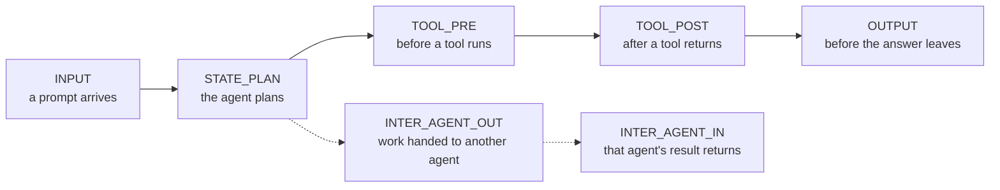

# fourverdicts

**Four verdicts for governing agentic AI: allow, modify, require approval, deny.**
A reference edition by Advaita AI.

Most guardrails watch a prompt go in and an answer come out. Agents do more than answer: they plan,
call tools that move money or change systems, keep state, and hand work to other agents. Governing
an agent means looking at those moments, and deciding at each one.

> This is an illustrative reference edition, built to explain how agentic AI can be governed. It is
> small on purpose. It is not production software.

## The four verdicts
| Verdict | Meaning |
|---|---|
| `ALLOW` | Proceed unchanged. |
| `MODIFY` | Proceed with an amended payload, for example a capped amount. |
| `REQUIRE_APPROVAL` | Pause until a person approves. |
| `DENY` | Block the action. |

When several policies disagree, the strictest verdict wins: deny, then require approval, then modify,
then allow.

## Seven points where an agent can be governed


## A policy in a few lines
```python
from fourverdicts import BasePolicy, ExecutionPhase, PolicyResult

class NoLargeTransfers(BasePolicy):
    def __init__(self, limit):
        super().__init__("no-large-transfers", phases=frozenset({ExecutionPhase.TOOL_PRE}))
        self.limit = limit

    def evaluate(self, payload, context):
        if payload["amount"] > self.limit:
            return PolicyResult.deny(self.rule_id, f"{payload['amount']} is above {self.limit}")
        return PolicyResult.allow(self.rule_id, "within the limit")
```
Run the full example: `PYTHONPATH=src python3 examples/hello_policy.py`

Two settings matter for every policy:
- **Enforcement mode:** `BLOCK` (a violation is a deny), `ESCALATE` (ask a person instead), or
  `WARN_ONLY` (shadow mode: record what would have happened).
- **Fail mode:** what happens when the policy itself crashes. The default, `FAIL_CLOSED`, denies. A
  governance layer that waves actions through when it breaks is not governing.

## What is in this edition, and what comes next
- **Now:** the vocabulary (verdicts, phases), the policy interface, and an example.
- **Next:** how several policies reach one decision, and what happens when the governance layer is
  overloaded.
- **After that:** a runnable demo of an agent making a transfer that is allowed, capped, denied or
  sent for approval.

## Run the tests
```
PYTHONPATH=src python3 -m unittest discover -s tests
```
Python 3.11 or later. No dependencies.

## How this was built
This edition was written with AI assistance (Anthropic's Claude), under my direction. I decided what it
should do, how the verdicts combine, and where it should fail closed. The AI wrote the code from that design.

How it was checked:
- Unit tests, run on Python 3.11 and 3.14 on every change.
- Deliberate-breakage checks: I broke the code seven ways (for example, making the strictest verdict
  the loosest) and confirmed the tests caught each one.
- A review by a second AI model from a different family, run in a fresh session that had not seen the
  first one's reasoning. It found three defects, including a policy that could change the payload in
  place without the engine noticing, and two untested behaviours. They were fixed before publication,
  with tests.

I am responsible for what is published here.

## Licence
Apache 2.0. See `LICENSE` and `NOTICE`.
