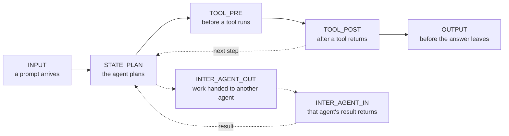

# fourverdicts

**Four verdicts for governing agentic AI: allow, modify, require approval, deny.**
A reference edition by Advaita AI.

Most guardrails watch a prompt go in and an answer come out. Agents do more than answer: they plan in
loops, call tools that move money or change systems, and hand work to other agents. Governing an
agent means looking at those moments, and deciding at each one.

> This is an illustrative reference edition, built to explain how agentic AI can be governed. It is
> small on purpose. It is not production software.

## The four verdicts
| Verdict | Meaning |
|---|---|
| `ALLOW` | Proceed unchanged. |
| `MODIFY` | Proceed with an amended payload, for example a capped amount. |
| `REQUIRE_APPROVAL` | Pause until a person approves. |
| `DENY` | Block the action. |

When several policies disagree, the strictest verdict wins: deny, then require approval, then modify,
then allow.

## Seven points where an AI agent can be governed


<p align="center"><sub>Ghanasham Apte · Advaita AI · github.com/g-apte/fourverdicts</sub></p>

## A policy in a few lines
```python
from fourverdicts import BasePolicy, ExecutionPhase, PolicyResult

class TransferLimit(BasePolicy):
    def __init__(self, limit):
        super().__init__("transfer-limit", phases=frozenset({ExecutionPhase.TOOL_PRE}))
        self.limit = limit

    def evaluate(self, payload, context):
        amount = payload["amount"]
        if amount <= self.limit:
            return PolicyResult.allow(self.rule_id, "within the limit")
        if amount <= 2 * self.limit:   # cap it
            return PolicyResult.modify(self.rule_id, {**payload, "amount": self.limit},
                                       f"capped at {self.limit}")
        return PolicyResult.deny(self.rule_id, f"{amount} is more than twice the limit of {self.limit}")
```
Run the full example: `PYTHONPATH=src python3 examples/hello_policy.py`

```
transfer    250: ALLOW  (within the limit)
transfer   1500: MODIFY (capped at 1000)
transfer   5000: DENY   (5000 is more than twice the limit of 1000)
```

Two settings matter for every policy:
- **Enforcement mode:** `BLOCK` (a violation is a deny), `ESCALATE` (ask a person instead), or
  `WARN_ONLY` (shadow mode: record what would have happened).
- **Fail mode:** what happens when the policy itself crashes. The default, `FAIL_CLOSED`, denies. A
  governance layer that waves actions through when it breaks is not governing.

## What is in this edition, and what comes next
- **Now:** the vocabulary (verdicts, phases), the policy interface, and an example.
- **Next:** how several policies reach one decision, and what happens when the governance layer is
  overloaded.
- **After that:** a runnable demo of an agent making a transfer that is allowed, capped, denied or
  sent for approval.

## Known gaps
- **Memory.** What an agent reads from and writes to long-term memory is not governed here. If memory
  is reached through a tool call, that call passes `TOOL_PRE` and `TOOL_POST` like any other tool;
  memory built into an agent framework is not seen at all. It is an open question, and an important one.

## Run the tests
```
PYTHONPATH=src python3 -m unittest discover -s tests
```
Python 3.11 or later. No dependencies.

## Talk to me
fourverdicts is a taster. If you are putting AI agents into production and need to show what they were
allowed to do, that is what I work on at Advaita AI: policies, approval steps and evidence an auditor
can check.

- Message me on [LinkedIn](https://www.linkedin.com/in/ghanashamapte/)
- Questions or ideas about this repository: open an issue.

## How this was built
This edition was written with AI assistance (Anthropic's Claude), under my direction. I decided what it
should do, how the verdicts combine, and where it should fail closed. The AI wrote the code from that design.

How it was checked:
- Unit tests, run on Python 3.11 and 3.14 on every change.
- Deliberate-breakage checks: I broke the code on purpose (for example, making the strictest verdict
  the loosest) and confirmed the tests caught each break.
- A review by a second AI model from a different family, run in a fresh session that had not seen the
  first one's reasoning. It found three defects (for example, a policy could change the payload in place
  without the engine noticing), two behaviours that had no tests, and three smaller improvements.
  All of it was fixed before publication, with tests.

I am responsible for what is published here.

## Licence
Apache 2.0. See `LICENSE` and `NOTICE`.
